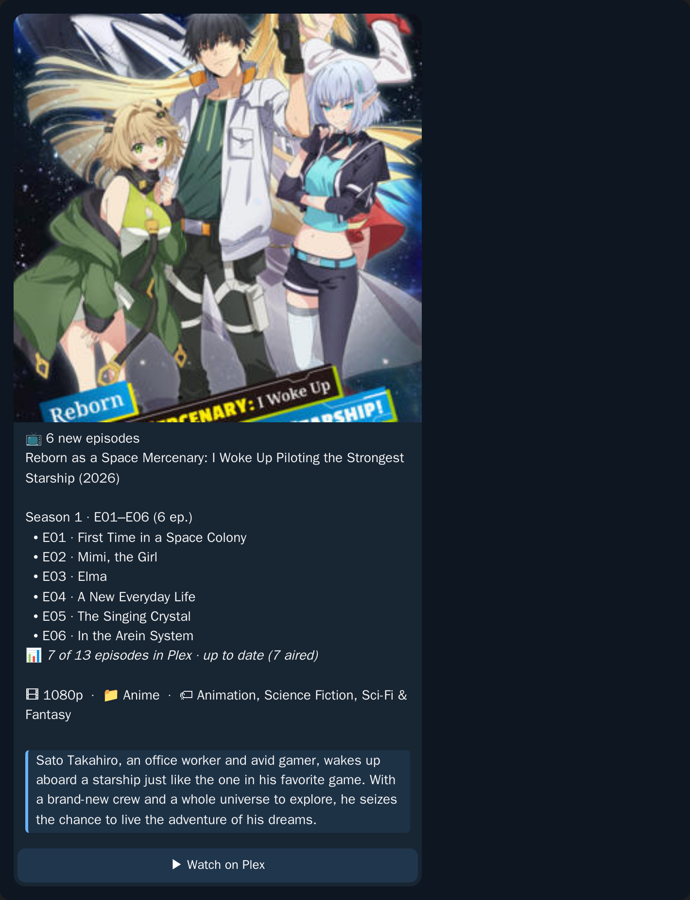
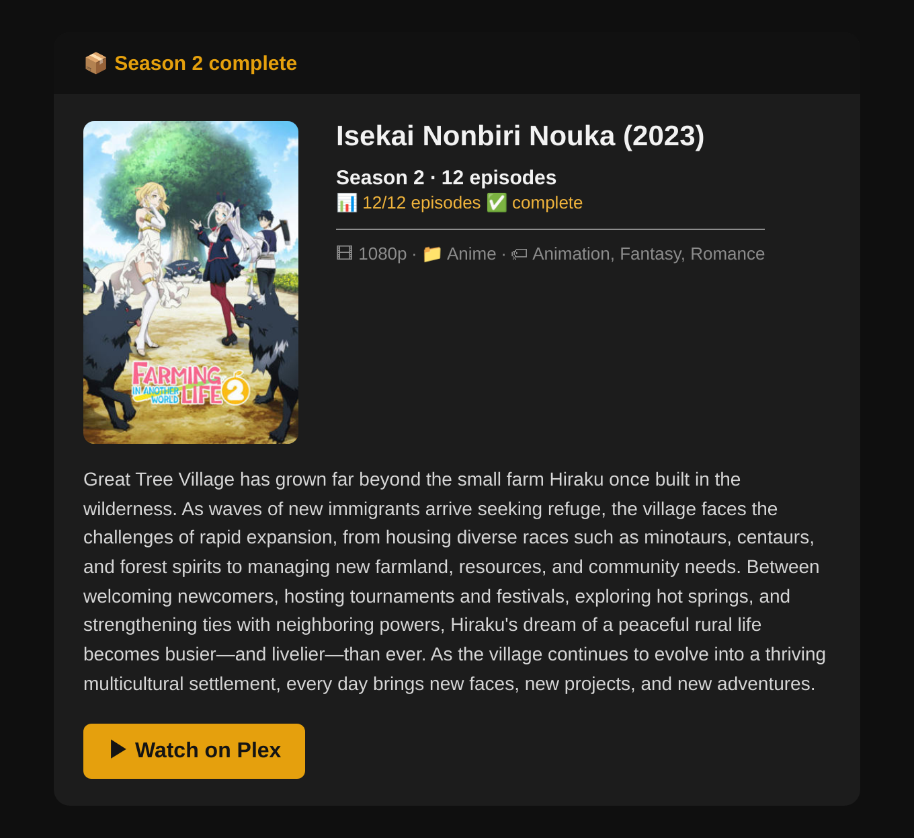
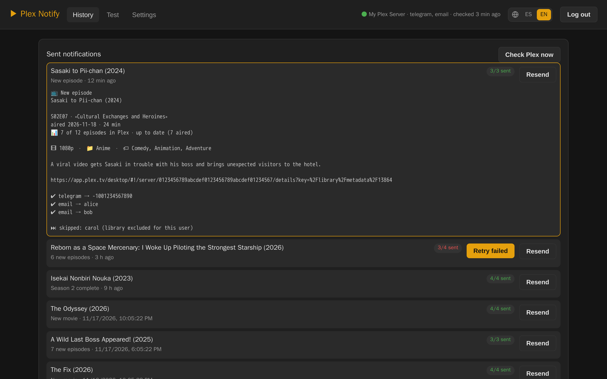
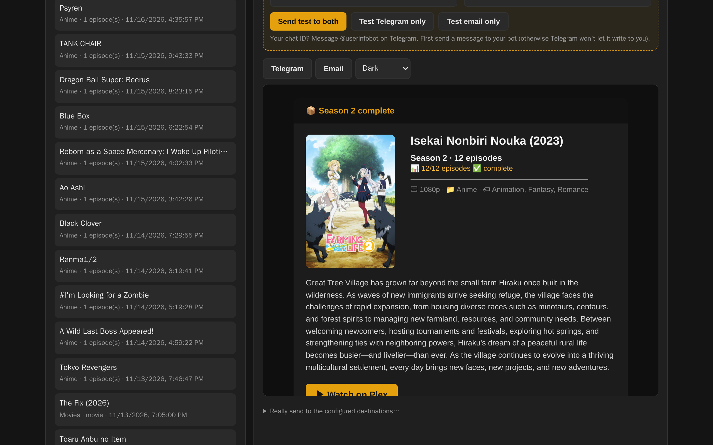
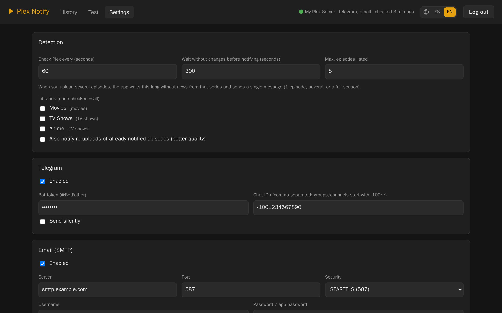
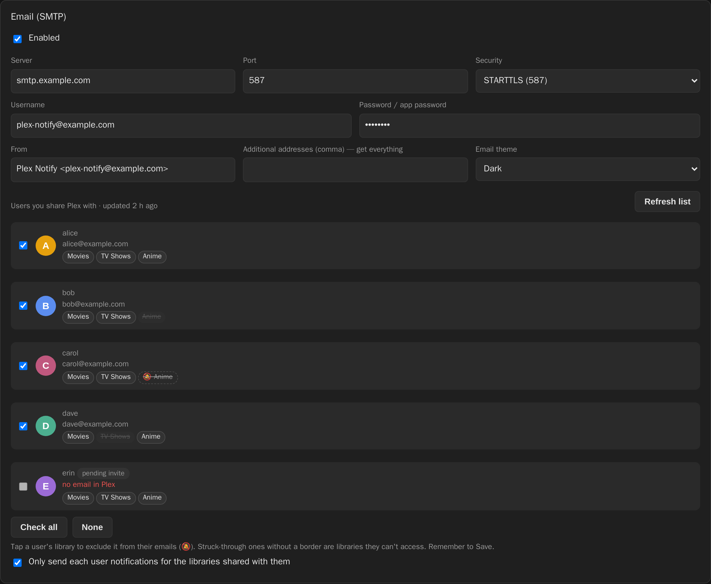
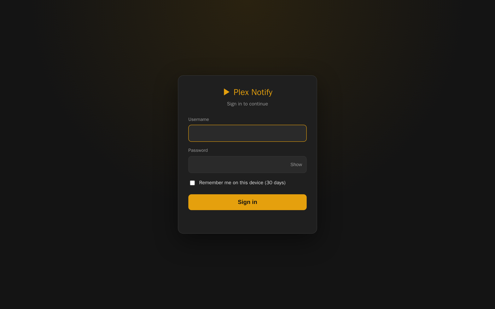

# Plex Notify

**English** · [Español](README.es.md)

Sends a notification through **Telegram**, **email** or other services (via [Apprise](https://github.com/caronc/apprise)) when something new is added to Plex.

It started as a replacement for Tautulli's notifications. It understands what was actually added: a single episode is announced as a single episode, not as a "complete series".

## Screenshots

| Telegram | Email (dark theme) |
|---|---|
|  |  |

<details>
<summary>More screenshots of the web UI</summary>

**History**


**Test: preview with real uploads and test-only destinations**


**Settings**


**Email recipients: Plex users, library access and per-user exclusions**


**Sign-in**


</details>

## What it detects

It waits a few minutes without news from the same series (5 by default) and then sends **a single message** with everything that arrived:

| Case | Example headline |
|---|---|
| 1 episode | 📺 New episode · S02E05 «Title» |
| Several episodes | 📺 10 new episodes · Season 3 · E41–E50 |
| A whole season at once | 📦 Season 4 complete |
| The episode that completes a season | 🏁 Season 1 completed |
| Several seasons | 📚 50 new episodes in 5 seasons |
| New series in the library | 🆕 New series · … |
| Complete series with several seasons | 🏆 Complete series · N seasons |
| Movie | 🎬 New movie |

The real episode count of each season and its air dates come from Plex's metadata service. That way the message can say "5 of 26 · up to date", "missing E03, E07" or "12/12 ✅ complete".

> Seasons that Plex has not matched (`local://`) have no total: the message only says how many episodes are in Plex.

## Channels

- **Telegram:** poster, text, collapsible summary and a "▶ Watch on Plex" button.
- **Email (SMTP):** HTML with the poster, in a **Dark**, **Light** or **Automatic** theme.
  - **Plex users:** pick recipients from the list of users you share the server with (read from plex.tv and refreshed every 6 h).
  - **Library filter:** with the option enabled, each user only gets notifications for the libraries shared with them.
  - **Per-user exclusions:** tap a library of a person to exclude it from their emails (🔕), even if they have access.
  - **Privacy:** one individual email is sent per person, so nobody sees the other addresses.
  - **Additional addresses:** get everything, unfiltered.
- **Apprise:** Discord, ntfy, Pushover, Gotify, Slack, etc. One URL per line.

Deliveries that fail because of network errors are retried automatically. They can also be retried or resent from the History tab.

## Language

The web UI and the notifications are available in **English** and **Spanish**. Switch with the **ES | EN** selector in the top bar; the chosen language applies to the web UI and to the notifications sent from then on.

- **Initial language:** set `APP_LANG=en` in `.env`. It is only used the first time.
- **Text that comes from Plex:** summaries, genres and episode titles are shown in the metadata language of each library, because that is how Plex provides them.

## Installation

Requires Docker with Docker Compose.

```bash
git clone https://github.com/r34lcl/Plex-Notify.git
cd Plex-Notify
cp .env.example .env
nano .env                     # fill in PLEX_TOKEN and APP_PASSWORD (and APP_LANG=en for English)
docker compose up -d --build
docker logs -f plex-notify
```

Open `http://<server>:8092`, sign in with `APP_USER` / `APP_PASSWORD` and set up the channels in **Settings**.
The name of your Plex server should show up in green at the top right.

On its first start, the app starts from "now": it does not notify what was already in Plex.

### Plex address

In `docker-compose.yml`, `PLEX_URL` points to `host.docker.internal` by default, meaning Plex runs on the same machine.
If Plex is on another host, use its IP (for example `http://192.168.1.10:32400`) and remove the `extra_hosts` block.

To check that Plex is reachable: `curl -s http://192.168.1.10:32400/identity`.

### How to get the PLEX_TOKEN

- **From Plex Web:** open any movie → `⋯` → **Get Info** → **View XML**. The token is the value of `X-Plex-Token=` in the URL.
- **From the server:** it is in Plex's `Preferences.xml`, attribute `PlexOnlineToken`.

Use the token of the server's **owner** account; with it the app can read the list of shared users.

### If the container has no internet access

If deliveries to Telegram or plex.tv fail with `ConnectTimeout`, `timed out` or `Errno 97`, but `curl` works from the server itself, use the host network directly:

```yaml
services:
  plex-notify:
    build: .
    container_name: plex-notify
    restart: unless-stopped
    env_file: .env
    network_mode: host
    environment:
      - PLEX_URL=http://127.0.0.1:32400
    volumes:
      - ./data:/data
```

With `network_mode: host`, the web UI listens on the server's `APP_PORT` (8000 by default). If it is taken, set another one in `.env` (for example `APP_PORT=8092`).

> With the normal network (`ports: "8092:8000"`) do **not** set `APP_PORT`: the app would listen on a different internal port and the web UI would not respond.

## Using the web UI

- **History:** sent notifications, who got them, who was skipped and why, and what is waiting to be grouped. "Check Plex now" forces a check.
- **Test:** pick a real recent upload and see how it would look on Telegram or by email.
  - **🧪 Test destinations:** a Telegram chat ID and an email address that only get tests, never the real notifications.
  - **Chat ID:** message @userinfobot on Telegram. First send a message to your bot, otherwise Telegram won't let it write to you.
  - **Real delivery:** "Really send to the configured destinations…" is collapsed and asks for confirmation.
- **Settings:** check interval, grouping wait time, libraries, max. episodes listed and the Telegram, SMTP and Apprise settings.

**Max. episodes listed:** how many episodes are shown one by one with their title; the rest become "… and N more". Telegram limits a photo caption to 1024 characters, so if it doesn't fit, the app shortens the summary first and then the list.

### Sign-in

- **Remember me** keeps the session for 30 days; without it, it lasts 12 h.
- 5 failed attempts in a row lock that IP out for 5 minutes.
- Changing `APP_PASSWORD` and applying it with `docker compose up -d` closes every open session.
- The API also accepts Basic Auth (`curl -u user:password`).

If you expose the web UI to the internet, put it behind a reverse proxy with HTTPS.

## Files

| Path | Contents |
|---|---|
| `app/` | Code (FastAPI + SQLite) |
| `.env` | `PLEX_TOKEN`, `APP_USER`, `APP_PASSWORD`, `APP_LANG` (**secret**, not versioned) |
| `data/plex-notify.db` | Settings, history and record of what was already notified. **Contains tokens and passwords**, not versioned |

## Useful commands

```bash
docker compose up -d --build     # start / apply code changes
docker compose down              # stop
docker logs -f plex-notify       # see detections and delivery results
```

If you change something in `.env`, use `docker compose up -d`: `restart` does not re-read `.env`.

## Moving to another server

All the configuration lives in `.env` and `data/`. Stop the app, copy the whole folder to the new server (over a private channel, such as `scp`) and start it there. It picks up exactly where it left off, and whatever was added to Plex while it was stopped is notified when it starts.

Don't keep both copies running at the same time: every notification would arrive twice.

## License

Plex Notify is free software under the [Apache License 2.0](LICENSE). You can use, modify, fork and redistribute it, including for commercial purposes, as long as you:

- keep the `LICENSE` and `NOTICE` files in your copy or derived work, crediting the original project: **Plex Notify by [KqK.cl](https://kqk.cl)** — <https://github.com/r34lcl/Plex-Notify>;
- state in the files you modify that they were changed.

It is provided "as is", without warranty. See the full text in `LICENSE`.

Plex Notify is not affiliated with Plex Inc. "Plex" is a trademark of its respective owners.

The screenshots use sample data (server, users and history); posters and titles belong to their respective owners.
